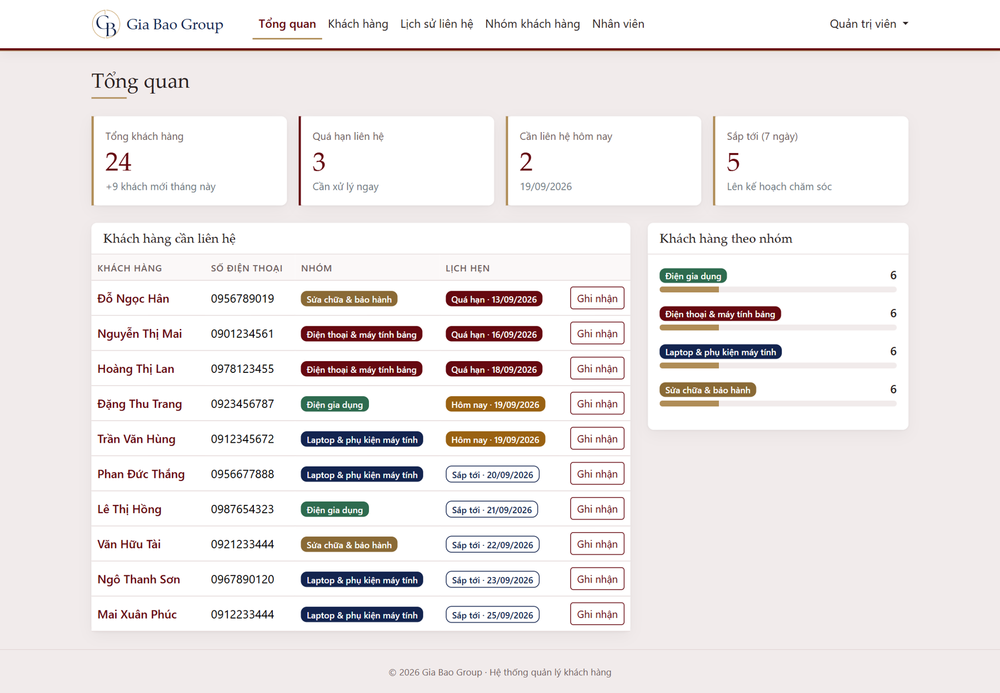
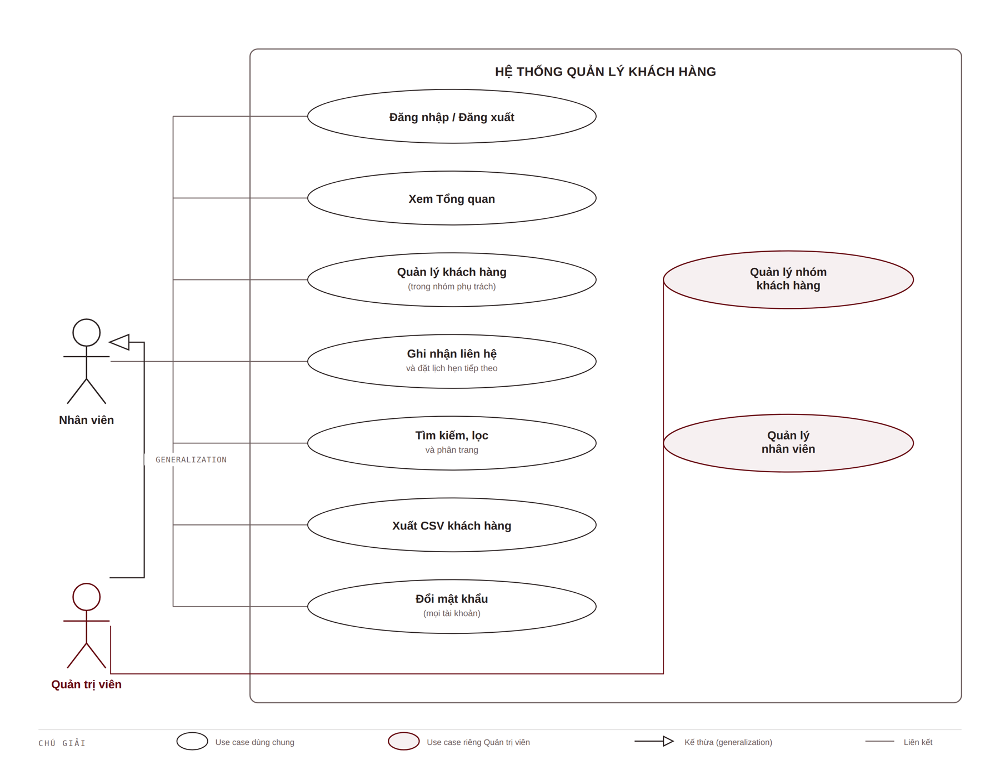
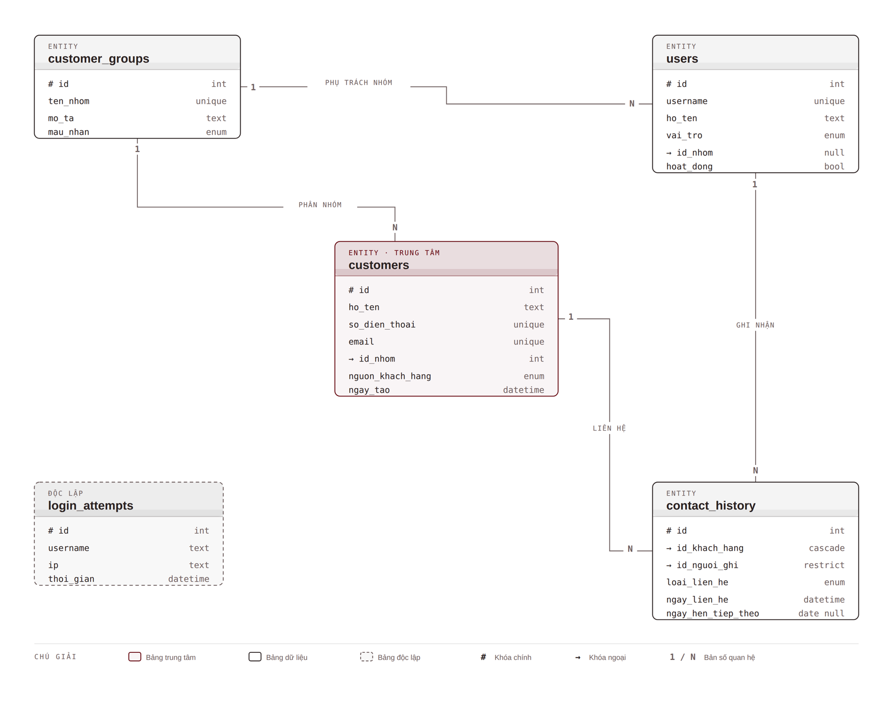
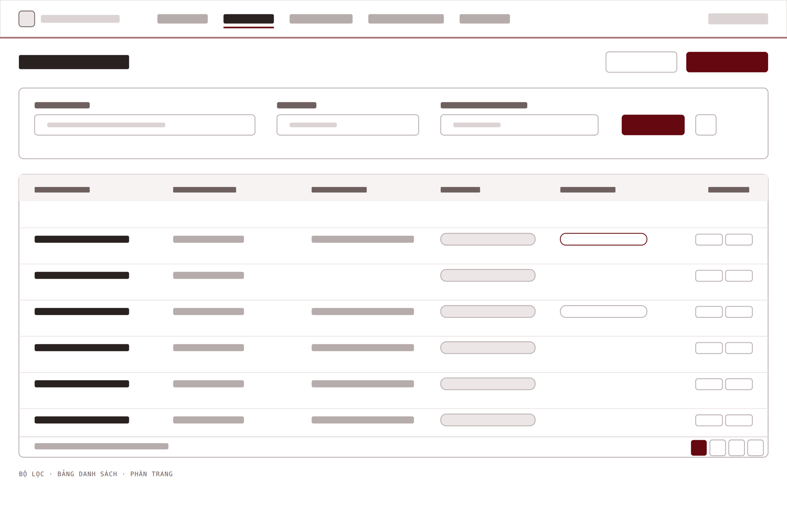
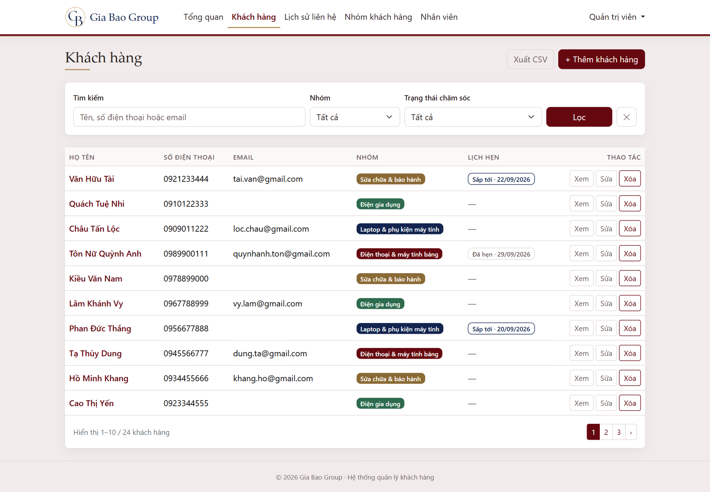

# Customer Care CRM for an Electronics Retailer

A web app that replaces notebooks, Excel sheets and Zalo chats in a small electronics store: one customer database, the full contact history of every customer, and reminders for the next follow-up. Built as a course project (PHP Web Programming) by **Tran Gia Bao**, starting from the business process rather than the code.

## Try it in one click

1. Click the button above (a free GitHub account is enough). GitHub builds PHP 8.2 + MariaDB with the sample data, which takes about 2 minutes the first time.
2. The app opens in a new browser tab. If it does not, open the **PORTS** tab and click the globe icon next to port 80.
3. Log in with a demo account:

| Username | Password | Role |
|---|---|---|
| `admin` | `Admin@123` | Admin: everything, including customer groups and staff accounts |
| `nvdienthoai` | `NhanVien@123` | Staff, owns the "Phones & tablets" customer group |
| `nvlaptop` | `NhanVien@123` | Staff, owns the "Laptops & accessories" group |

**Run locally instead:** `docker compose up`, then open http://localhost:8080. Or use XAMPP: see [README.vi.md](README.vi.md).

The interface is in Vietnamese. Sample dates are generated relative to the day the database is created, so the dashboard always shows overdue, due-today and upcoming follow-ups.

## Business analysis behind it

| Step | Output |
|---|---|
| AS-IS analysis | Customer data scattered across paper notes, personal Excel files and Zalo chats; follow-ups depend on memory |
| TO-BE process | Central customer records grouped by product interest, every contact logged with who made it, next follow-up date on each contact |
| Scope gap found | The brief asked for one admin role. The store actually assigns staff per product group, so the design added staff accounts that own one group each |
| Use cases | Use case diagram plus specifications for "Log a contact and set the next follow-up" and "Manage customers in my group" |
| Data model | ERD with 5 tables, foreign keys, `UNIQUE` and `CHECK` constraints |
| Wireframes | Dashboard, customer list and contact form drawn before development |
| Testing | 15 test cases, 15 passed, covering role-based access, validation, SQL injection, XSS and CSRF ([KIEM_THU.md](KIEM_THU.md)) |

| Use case diagram | ERD |
|---|---|
|  |  |

| Wireframe | Built screen |
|---|---|
|  |  |

### Business rules

- A customer's current follow-up is the next date set on their **latest** contact. Logging a new contact replaces the old follow-up.
- Follow-up status: **Overdue** (date passed), **Today**, **Upcoming** (next 7 days), **Scheduled** (later).
- Staff can view every customer but can only add, edit, delete or log contacts for customers in their own group. New customers created by staff always go into the staff member's group, whatever the form sends.
- A contact cannot be in the future, and the next follow-up cannot be before the contact date.
- Phone numbers are 10 digits starting with 0 and unique; emails are unique.
- Five wrong passwords for one username from one IP within 15 minutes block further attempts.

## Features

Dashboard with follow-up counts and customers per group · customer list with search, filters, pagination and CSV export for Excel · customer profile with a contact timeline · contact log with date and group filters · customer group and staff management (admin) · password change · responsive layout for phones.

## Tech stack

PHP 8 (no framework), PDO with prepared statements, MySQL / MariaDB, Bootstrap 5.3 (bundled locally), vanilla JavaScript. Security: CSRF tokens, `password_hash`, output escaping, session hardening, login throttling, server-side authorization.

Full write-up (Vietnamese): [docs/BaoCao_Detai44.pdf](docs/BaoCao_Detai44.pdf)

## Contact

Tran Gia Bao · Gcn1135@gmail.com · [Portfolio](https://ge3be3.github.io)
